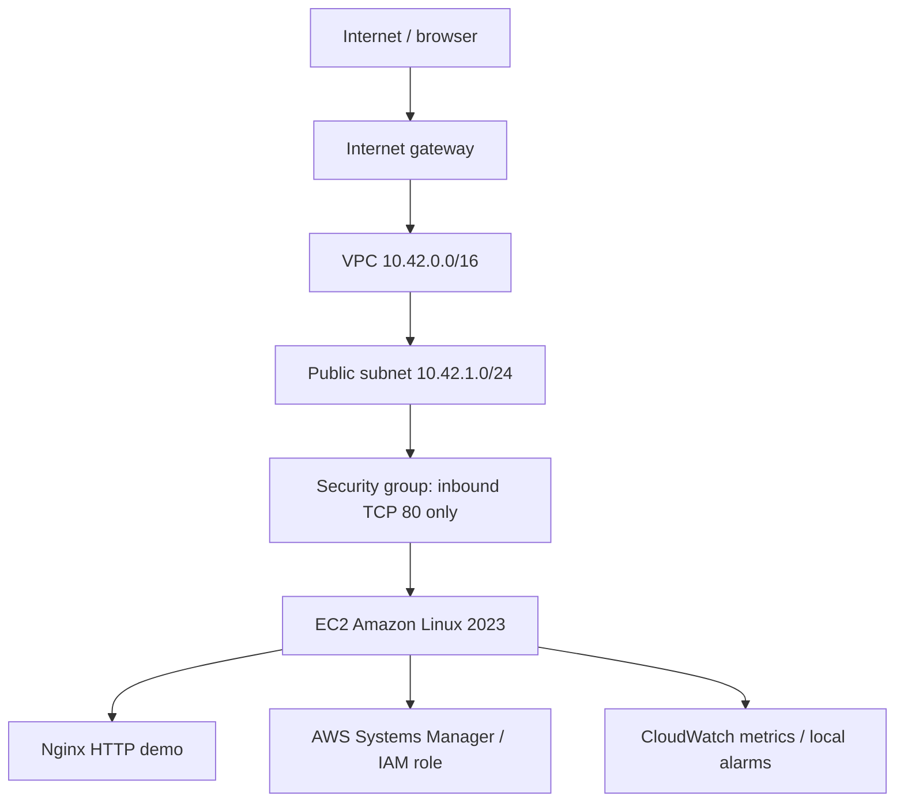

# AWS Infrastructure Deployment — Terraform + EC2 + Nginx

**Cloud support engineering portfolio lab** demonstrating infrastructure-as-code, AWS networking, least-exposure administration, Linux service bootstrapping, and CloudWatch alarms.

> **Status:** Source code only. This repository does **not** mean that a live AWS environment has been deployed or tested. Nothing runs in AWS until the user supplies credentials and explicitly runs `terraform apply`.

## What this builds

- Dedicated VPC, public subnet, internet gateway, route table and association
- Amazon Linux 2023 EC2 instance (`t3.micro` by default), using the region's current x86_64 AMI from AWS Systems Manager public parameters
- Nginx installed and started through EC2 user data; sample static landing page
- Security group exposing **HTTP port 80 only**, no inbound SSH
- IAM instance role with `AmazonSSMManagedInstanceCore` for administration via Systems Manager Session Manager
- EC2 with encrypted 8 GiB root EBS volume and IMDSv2 enforced
- CloudWatch alarms for instance status-check failures and CPU above 80%, **without notifications**
- Terraform outputs for instance ID, public IP, demo URL and SSM session command

### Architecture



A public subnet is used for this *training lab* to keep the architecture inspectable and inexpensive. For production, prefer private subnets, HTTPS termination, a load balancer, restricted egress and stronger observability.

## Prerequisites

- Terraform CLI **1.6+** and AWS provider v5/v6 (downloaded by `terraform init`)
- AWS account with permission to create VPC, EC2, IAM, CloudWatch and related resources
- AWS CLI configured with an authorized account/profile
- An AWS region supporting the selected instance type, Amazon Linux 2023 and Systems Manager
- Funds / billing controls for running cloud infrastructure

No AWS account is needed to browse the code or run the Python checks in this repo.

## Costs and security — read before deployment

**AWS resources can cost money**, including EC2 compute, EBS storage, public IPv4 addresses, data transfer and any applicable monitoring charges. Do not assume free-tier eligibility. This lab does not automatically turn itself off. Review prices for your region, set an AWS Budget alert, and run `terraform destroy` when finished. Verify charges and resource deletion in the AWS console.

**HTTP is unencrypted** and is used *only* to demonstrate web connectivity, not to serve private content. The default `allowed_http_cidrs = ["0.0.0.0/0"]` exposes the sample page to the internet; prefer your own `/32` IP where possible. No SSH port is opened. Session Manager requires SSM permissions and outbound HTTPS reachability. Never commit credentials, state files, or real customer data.

## Deployment (optional; creates billable AWS resources)

```bash
cd terraform
cp terraform.tfvars.example terraform.tfvars
# Review terraform.tfvars and the files before continuing
terraform init
terraform fmt -check
terraform validate
terraform plan -out=tfplan
terraform apply tfplan
terraform output
```

The default deployment is in `us-east-1` and provisions a public web lab. Terraform uses the credentials from your AWS SDK/CLI environment; no keys are stored in code.

For an HTTP-only smoke test, after confirming deployment:

```bash
python scripts/smoke_test.py http://PUBLIC_IP
```

Run the Python script from the **repository root** (not from `terraform/`). Alternatively use `curl -I http://PUBLIC_IP`.

**Note:** Nginx provisioning occurs during first-boot cloud-init, so the URL may not respond immediately after the EC2 instance enters `running` state. Diagnose with the runbooks, not by repeatedly applying Terraform.

## Access the Linux host (no SSH keys)

After AWS Systems Manager sees the instance as managed, get the command with:

```bash
cd terraform
terraform output -raw ssm_start_session_command
```

Use the printed command with an authorized CLI account and the Session Manager plugin. Example troubleshooting commands *inside* the instance:

```bash
sudo systemctl status nginx
sudo journalctl -u nginx --no-pager -n 50
sudo tail -n 80 /var/log/cloud-init-output.log
curl -I http://127.0.0.1
```

See [incident and troubleshooting runbooks](docs/RUNBOOKS.md).

## Clean up to stop charges

```bash
cd terraform
terraform destroy
```

Confirm in the console that the instance, EBS volume, public IPv4 assignment, network resources and alarms are gone. Terraform state is local by default; never commit it. For team environments, configure protected remote state and locking before collaboration.

## Validate without an AWS account

```bash
python -m unittest discover -s tests -v
```

These are **source-level offline checks**, not a replacement for `terraform validate` or real deployment testing. CI runs both Python checks and Terraform format/syntax validation. Terraform validation downloads the AWS provider but does not call `terraform apply`.

## Project contents

```text
terraform/
  versions.tf             Terraform and AWS provider requirements
  variables.tf            Region, VPC, server and firewall parameters
  main.tf                 VPC, networking, EC2, IAM, SG, CloudWatch
  outputs.tf              Demo URL and identifiers
  user_data.sh            Amazon Linux Nginx bootstrap
  terraform.tfvars.example
scripts/smoke_test.py     Optional HTTP smoke check
scripts/architecture.py   Generate a readable component inventory
scripts/validate_source.py  Offline structural validation
examples/                 Sample **simulated** incident report
samples/                  Placeholder example outputs (not actual AWS results)
docs/RUNBOOKS.md          Hands-on AWS troubleshooting guide
.github/workflows/ci.yml Automated checks (no deployment)
```

## Portfolio discussion points

Explain how an HTTP request reaches the EC2 instance through a route table, internet gateway and security group; why the instance exposes no SSH port; how IAM and SSM provide management access; why IMDSv2 and encrypted EBS matter; how to investigate a failed Nginx bootstrap; and how to avoid unexpected AWS charges.

This repository is an educational sample, **not evidence of a production AWS rollout**. The MIT license permits reuse with attribution.
